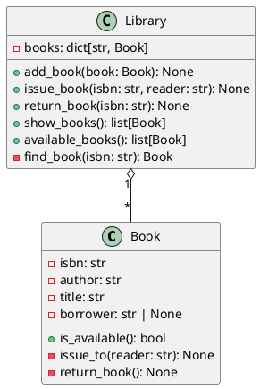

# Проектирование классов

## UML-эскиз

## Ответы на вопросы

1 ISBN, автор и название не должны меняться. Это данные, по которым библиотека узнаёт и находит книгу. Состояние и имя читателя могут меняться при выдаче и возврате.

2 в Book, потому что именно книга должна знать, доступна она и кто её взял. library хранит книги и вызывает методы книги, когда выдаёт или принимает её

3 публичные - методы для обычной работы (добавить книгу, выдать, принять возврат и посмотреть списки). find_book лучше оставить внутренним тк это вспомогательный поиск. (если сделать его публичным, другие части программы смогут обращаться к внутренней логике библиотеки и могут неверно обрабатывать отсутствующую книгу)
